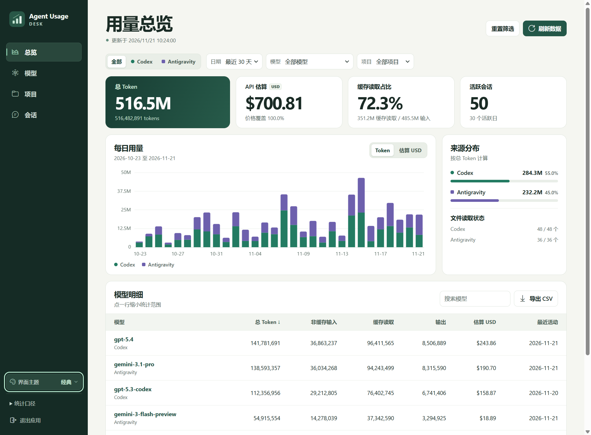

# Agent Usage Desk

**一扇 Windows 窗口，查看 Codex 和 Google Antigravity 在这台电脑上留下的用量。**

Agent Usage Desk 从两款应用的本地记录统计 token，按模型、项目和会话查看趋势，并按标准 API 单价估算同等用量的美元成本。适合回答「今天用了多少」「哪个项目占得最多」和「如果按 API 单价计，大概值多少钱」。



## 下载并打开

1. 在 [Releases](https://github.com/shushuyang231/agent-usage-desk/releases/latest) 下载 `Agent-Usage-Desk-0.2.0-windows-x64.exe`。
2. 双击启动。程序会在独立窗口打开，并自动扫描本机已有的用量记录。首次扫描的耗时取决于记录数量。
3. 选择 **Codex**、**Antigravity** 或 **全部**，再用日期、模型和项目缩小范围。

需要 Windows 10 / 11 x64、.NET Framework 4.8 或更新的 4.x 版本，以及 [Microsoft Edge WebView2 Runtime](https://developer.microsoft.com/microsoft-edge/webview2/)。这个版本采用便携单文件分发，当前没有数字签名。日常打开和刷新无需登录或提供 API Key。升级时先关闭旧版窗口，再打开新版。

## 界面能看什么

| 视图 | 可以查看的内容 |
| --- | --- |
| 总览 | 总 token、API 估算、缓存读取占比、活跃会话、逐日趋势和来源占比 |
| 模型 | 各模型的 token 构成、费用估算和最近使用日期 |
| 项目 | 按工作目录汇总，点项目名可查看该项目的趋势 |
| 会话 | 按标题或会话标识查看单次会话在所选日期范围内的累计用量 |

趋势图可在 **Token** 和 **估算 USD** 之间切换，长日期范围按周汇总。悬停或聚焦图表后按左右方向键，可查看对应日期的数值。表格支持搜索、排序和分页，**导出 CSV** 会导出当前筛选与搜索范围的全部明细。

## 本地主题

经典版沿用纯色看板。本地定制包的侧栏 **界面主题** 可以在经典、星弦和花月之间切换。切换会保留当前视图和筛选，应用也会记住上次使用的主题。

定制插画可以放在 `ui/local-art/starlight.png` 和 `ui/local-art/flowers.png`，构建时会随程序打包。普通源码检出仅包含经典版，已就位的插画会自动启用对应主题。插画目录在 Git 忽略列表中。

## 工作原理

1. **读取本机记录。** Codex 适配器读取 `CODEX_HOME` 或 `%USERPROFILE%\.codex` 下的活动及归档会话日志，支持普通和 Zstandard 压缩的 JSONL。Antigravity 适配器以只读方式从 `GEMINI_CLI_HOME` 或 `%USERPROFILE%\.gemini` 下的兼容会话数据库提取计量元数据，包含桌面版。项目来自记录中的工作目录或工作区。
2. **处理增量并建立索引。** 应用区分累计计数和当次计数，并合并重复的计量记录。SQLite 索引缓存按日期、来源、模型、项目和会话聚合的结果，刷新时优先处理新增和变化的文件。
3. **在本机显示。** 独立窗口使用 WebView2 加载看板，本地服务绑定在 `127.0.0.1` 的随机端口，使用每次启动新生成的随机路径。图表、样式和价格表随程序打包。应用没有用量上传或在线价格查询功能。

数据范围取决于本电脑保留的记录。跨设备、被清理或只存在于服务端的用量无法统计。日期按 Windows 本地时区显示。请求时间缺失时，应用用会话或文件时间近似归档，并在看板上标明。

## 费用怎样估算

每条计量记录分别按非缓存输入、缓存读取、缓存写入和输出的适用标准费率折算。输出包含日志记录的推理 token。支持分档的模型按单次输入量选择适用档位。估算采用 [内置价格表](pricing.py)，核对日期为 2026 年 11 月 21 日。供应商调整费率后，需要更新价格表。

- **金额带 `*`** 表示只有部分 token 有对应价格。价格覆盖率按 token 数计算。
- **金额显示 `—`** 表示所选范围没有可计价用量。缺价 token 会保留在总量中。
- **API 估算** 表示用量按标准文本费率的等价金额。订阅实付、加速档、按小时计费的缓存存储以及单独计费的工具调用都在该估算范围之外。

参考 [OpenAI API 定价](https://developers.openai.com/api/docs/pricing)、[Gemini API 定价](https://ai.google.dev/gemini-api/docs/pricing) 和 [Claude API 定价](https://platform.claude.com/docs/en/about-claude/pricing)。

## 本地数据

原应用的计量记录由本工具以只读方式访问。索引和 WebView2 配置保存在 `%LOCALAPPDATA%\AgentUsageDesk`。本地索引可能包含工作目录、模型、会话标识和用量。看板还会从已存在的标题索引读取会话标题。分享导出的 CSV 前，可检查其中的项目名及会话名。

## 从源码构建

在 Windows x64 上安装 Python 3.10 和 .NET Framework 4.8，打开 PowerShell，在仓库根目录运行：

```powershell
python -m venv .venv
.\.venv\Scripts\python.exe -m pip install -r requirements.txt
$env:Path = "$(Resolve-Path '.venv\Scripts');$env:Path"
.\build-windows.ps1 -Name 'Agent-Usage-Desk-0.2.0-windows-x64'
```

脚本下载固定版本的官方 WebView2 SDK，使用 Windows 自带的 .NET Framework 编译器编译 WinForms 窗口，再用 PyInstaller 生成 `dist\` 下的便携 EXE。构建需要联网下载依赖。已有 SDK 包时可通过 `-WebViewPackage` 指定本地文件。

| 文件 | 职责 |
| --- | --- |
| `readers.py` | 读取 Codex 和 Antigravity 的本机计量记录 |
| `engine.py` | 增量索引、按本地日期聚合和快照 |
| `pricing.py` | 标准文本 API 价格、模型归一和缺价计数 |
| `app.py`、`DeskWindow.cs` | 本地服务、独立窗口和启动退出 |
| `ui/` | HTML、CSS、原生 JavaScript 和 Canvas 图表 |

Antigravity 适配器参考了 [ccusage](https://github.com/ryoppippi/ccusage) v20.0.51 的 MIT 代码。第三方声明见 [THIRD_PARTY.txt](THIRD_PARTY.txt)。
